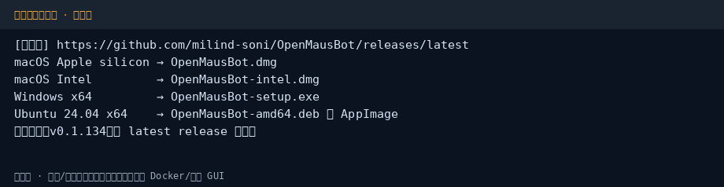
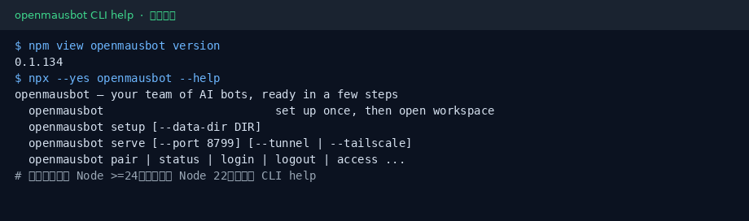
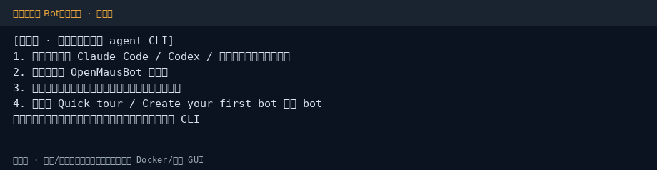

# OpenMausBot 小白中文教程

> 开源「多 Bot 聊天工作台」：本机 harness + 你已有的 agent CLI（社区非官方教程）  
> 上游：[`milind-soni/OpenMausBot`](https://github.com/milind-soni/OpenMausBot) · 官网：[openmausbot.com](https://www.openmausbot.com/) · 文档：[docs.openmausbot.com](https://docs.openmausbot.com/)  
> 教程校对：2026-11-05（Asia/Shanghai）· npm 包 **openmausbot@0.1.141**（`npm view` / `npx --help` 实测）；桌面 GUI 为**示意图**（01 / 03），CLI 为**真实截图**（02）

[](https://github.com/xianyu110/awesome-openmausbot-zh)
[](https://github.com/milind-soni/OpenMausBot)
[](LICENSE)
[](https://xianyu110.github.io/awesome-openmausbot-zh/)
[](https://www.npmjs.com/package/openmausbot)

---

## 目录

1. [这是什么？准备工作](#1-这是什么准备工作)
2. [桌面安装](#2-桌面安装推荐日常使用)
3. [npm CLI](#3-npm-cli服务--配对--vps)
4. [第一次对话](#4-第一次对话桌面)
5. [常用命令速查](#5-常用命令速查)
6. [进阶：服务器 / 手机 / 脚本](#6-进阶服务器--手机--脚本简)
7. [排查](#7-排查)
8. [许可证与合规](#8-许可证与合规)

---

## 1. 这是什么？准备工作

**OpenMausBot** 是一个开源的「多 Bot 聊天工作台」：本机跑一个 harness，把你已经安装并登录的 agent CLI（如 Claude Code / Codex / Grok 等）接到类似即时通讯的界面里。每个 bot 可以绑定不同引擎、记忆，以及（可选）本机 / 应用权限。

官方强调三点：

- **自带 agent**：用本机已有的 CLI；也可在 Settings → Engines 指向自定义二进制
- **本地优先**：默认本机回环地址管理进程；数据目录常见为 `~/.openmausbot`
- **开源**：上游 **Apache-2.0**；与任何同名加密货币**无官方关系**（见上游 README 警告）

本仓库只提供**中文小白教程**（MIT），不二次分发上游安装包。菜单名、版本号以官方为准；本文校对时 npm 包为 **openmausbot@0.1.141**。

### 官方链接（请以官方为准）

| 资源 | 链接 |
|------|------|
| 源码 | https://github.com/milind-soni/OpenMausBot |
| 官网 | https://www.openmausbot.com/ |
| 文档 | https://docs.openmausbot.com/ |
| 最新 Release | https://github.com/milind-soni/OpenMausBot/releases/latest |
| VPS / 自托管 | https://docs.openmausbot.com/docs/self-hosting/deploy-vps |
| npm `openmausbot` | https://www.npmjs.com/package/openmausbot |

### 截图说明

| # | 文件 | 类型 | 说明 |
|---|------|------|------|
| 1 | [`images/01-download.png`](images/01-download.png) | **示意图** | Releases 桌面安装包对照 |
| 2 | [`images/02-npm-cli.png`](images/02-npm-cli.png) | **真实** | `npm view` + `npx openmausbot --help` |
| 3 | [`images/03-first-bot.png`](images/03-first-bot.png) | **示意图** | 桌面端创建第一个 Bot 的步骤提纲 |

> CLI 真实输出采集于沙盒；官方引擎要求 **Node ≥ 24**。密钥、邮箱、私人路径不会出现在图中。

### 开始前 checklist

1. 先装好并**登录**你要用的 agent CLI（终端里能正常对话）
2. 个人日常用 → 走 **桌面安装包**（第 2 章）
3. VPS / 配对 / 脚本 → 准备 **Node.js ≥ 24**，走 **npm CLI**（第 3 章）
4. 引擎优先：DeepSeek / Ollama / 国内兼容端，或你**已经**付费登录的官方 CLI（见第 8 章合规）

## 2. 桌面安装（推荐日常使用）

### 环境要求（摘要）

- **macOS**（Apple silicon / Intel 各有 `.dmg`）、**Windows x64**（`.exe`）、**Ubuntu 24.04 x64**（`.deb` 或 AppImage，以 Release 说明为准）
- 先装好并登录要用的 agent CLI
- 版本以 [Releases · latest](https://github.com/milind-soni/OpenMausBot/releases/latest) 为准（撰写时与 npm **0.1.141** 同系列）

### 安装步骤

1. 打开 [Releases · latest](https://github.com/milind-soni/OpenMausBot/releases/latest)
2. 按系统下载：
   - Mac Apple silicon → `OpenMausBot.dmg`
   - Mac Intel → `OpenMausBot-intel.dmg`
   - Windows → `OpenMausBot-setup.exe`
   - Ubuntu → `OpenMausBot-amd64.deb`（或 Release 提供的 AppImage）
3. 按系统常规方式安装并打开应用
4. 也可使用官方 README 上的直链按钮（同一 Release 资源）



### 打开后先看哪里

- 模型 / Engines 选择器：确认本机 CLI 已被识别
- 不可用时：Settings → Engines 补安装或改自定义路径
- 数据目录一般在用户目录下的 `.openmausbot`（勿把含密钥的配置提交到公开仓库）

## 3. npm CLI（服务 / 配对 / VPS）

### 版本与引擎

```bash
# 需要 Node.js >= 24（package engines）
node -v
npm view openmausbot version   # 校对时为 0.1.141
```

低于 Node 24 时，部分功能可能无法跑通；`npx … --help` 往往仍能打印。

### 快速查看帮助（本教程实测）

```bash
npx openmausbot@0.1.141 --help
# 或全局安装后：
# npm i -g openmausbot
# openmausbot --help
```



### 顶层命令一览（摘自 `openmausbot --help`）

| 命令 | 作用（摘要） |
|------|----------------|
| `openmausbot` / `setup` | 首次配置：选 AI 访问方式、可选手机访问；保留已有 bot/聊天 |
| `start` | 按已保存设置打开工作区（等同默认入口） |
| `serve` | 启动服务端；可打印配对链接 + QR；支持 `--port` / `--data-dir` / `--tunnel` 等 |
| `pair` | 对运行中的服务签发配对码（`--client` 仅聊天；`--phone ios\|android`） |
| `sessions` | 列出已配对设备；`sessions revoke ID` 登出某设备 |
| `status` | 查看服务端自我描述 |
| `login` / `logout` | 用邮箱验证码登录 OpenMausBot 账号（tunnel 公网地址需先 login） |
| `access` | 管理可用邮箱登录 `/pair` 的名单（`list` / `add` / `remove`，可 `--chat-only`） |
| `service install\|uninstall` | 写入 systemd（Linux）或 launchd（macOS），开机自启 |
| `sentinel` | 只读健康扫描（也可经 `service install --sentinel` 定时） |
| `browser install\|status` | 安装 bot 用浏览器引擎（agent-browser）与 Chrome for Testing |
| `fleet …` | 一台 Linux 上多租户工作区（需 root / Caddy 等，见官方文档） |

### 常用启动示例

```bash
# 交互式首次配置
npx openmausbot@0.1.141 setup

# 本地启动服务（默认端口示例 8799，以 help 为准）
npx openmausbot@0.1.141 serve --port 8799

# Cloudflare tunnel 公网（需先 login）
npx openmausbot@0.1.141 login
npx openmausbot@0.1.141 serve --tunnel

# Tailscale / 自有域名
# openmausbot serve --tailscale
# openmausbot serve --domain your.host.example
```

`--no-open` 不自动开浏览器；`--no-pair` 跳过手机配对打印；`--local` 本次忽略已保存的远程访问设置。

完整子命令与参数以你本机 `openmausbot --help` 与 [官方文档](https://docs.openmausbot.com/) 为准。

## 4. 第一次对话（桌面）



按下面顺序走一遍，确认「引擎 → 工作区 → 消息」通路：

1. **终端先通**：确认本机 agent CLI 已能交互（例如已登录的 Claude Code / Codex）。合规优先用你已有订阅或国内兼容封装，见第 8 章。
2. **打开 OpenMausBot**：桌面安装包，或 CLI 的 `setup` / `start` / `serve` 打开工作区。
3. **核对 Engines**：在模型 / Engines 选择器中确认引擎可用；不可用时按提示补安装，或到 Settings → Engines 改路径。
4. **创建第一个 bot**：按官网 Quick tour /「Create your first bot」新建；发一条简单消息（例如「用一句话介绍你自己」）验证通路。
5. **权限从紧**：若启用「控制本机 / 云桌面 / 应用连接」等能力，只开你需要的权限，**先在非敏感目录试用**。
6. **可选健康检查（CLI）**：

```bash
openmausbot doctor          # 检查服务是否应答、引擎是否就绪
openmausbot bots            # 列出 bot
openmausbot models          # 列出引擎与模型
```

手机配对、公网 tunnel、多租户 `fleet` 见第 6 章与官方文档。

## 5. 常用命令速查

以下摘自 **openmausbot@0.1.141** 的 `--help`，方便复制；细节以本机 help 为准。

### 工作区运维

```bash
openmausbot setup
openmausbot start
openmausbot serve [--port 8799] [--data-dir DIR] [--tunnel|--tailscale|--domain HOST]
openmausbot status
openmausbot doctor
```

### 账号与配对

```bash
openmausbot login [--email you@example.com]
openmausbot logout
openmausbot pair [--label NAME] [--client] [--phone ios|android]
openmausbot sessions
openmausbot sessions revoke <ID>
openmausbot access list
openmausbot access add EMAIL [--chat-only]
openmausbot access remove EMAIL
```

### 驱动已运行的工作区（脚本 / CI / 其他 agent）

```bash
openmausbot bots | channels | models
openmausbot run BOT "do this"       # 下发任务并等到完成（含队友）
openmausbot send BOT "text"         # 发一条消息后立即返回
openmausbot wait BOT                # 等待已在跑的工作
openmausbot messages BOT            # 最近消息
openmausbot interrupt BOT [--tree]  # 相当于按 Stop
openmausbot export BOT --out DIR    # 导出 transcript / 文件 / 截图
openmausbot events [--job THREAD]   # 服务端事件 JSON Lines
openmausbot team apply FILE         # 用 team 文件对齐工作区
```

### 常驻与浏览器

```bash
openmausbot service install [--tunnel|--domain HOST|--tailscale] [--port N]
openmausbot service uninstall
openmausbot browser install [--with-deps]
openmausbot browser status
openmausbot sentinel [--once] [--json]
```

> 提示：`service` / `fleet` 建议先 `npm i -g openmausbot` 再装系统单元；`fleet` 多在 Linux + root / Caddy 场景，入门可先跳过。

## 6. 进阶：服务器 / 手机 / 脚本（简）

> 本章只给路线图；逐步操作以 [官方 self-hosting](https://docs.openmausbot.com/docs/self-hosting/deploy-vps) 与本机 `--help` 为准。

### 服务器（VPS）速览

1. 机器安装 **Node ≥ 24**，建议 `npm i -g openmausbot`
2. `openmausbot setup` 选好引擎与数据目录
3. 远程访问三选一（互斥思路，按场景选）：
   - `--tunnel`：Cloudflare 隧道公网地址，需先 `openmausbot login`
   - `--tailscale`：走 Tailscale MagicDNS（需已登录 Tailscale 并开启 HTTPS 证书）
   - `--domain HOST`：自有域名；会拉起 pinned Caddy 申请证书（DNS 指向本机，开放 80/443）
4. 需要开机自启：`openmausbot service install …`（Linux systemd / macOS launchd）
5. 多客户共用一台机：再看 `openmausbot fleet …`（复杂，适合运营场景）

### 手机配对（简）

1. 服务端已在跑（`serve` / `start` / `service`）
2. `openmausbot pair --phone ios` 或 `--phone android`（或桌面 UI 里的配对入口）
3. 手机扫码 / 输入配对码；仅聊天可用 `pair --client`
4. 管理设备：`openmausbot sessions`；踢掉某台：`sessions revoke <ID>`

### 脚本化对话（简）

适合 CI、定时任务、或让另一个 agent 调用：

```bash
openmausbot doctor
openmausbot run  my-bot  "总结今天仓库里的未合并 PR"
openmausbot send my-bot  "继续，只要结论"
openmausbot messages my-bot
openmausbot export my-bot --out ./omb-out
```

生产环境请限制 `access` 白名单，并避免把邮箱验证码、API Key、数据目录打进日志或公开仓。

## 7. 排查

| 现象 | 可能原因 | 处理 |
|------|----------|------|
| 引擎列表为空 | 未装或未登录对应 CLI | 先在终端跑通该 CLI；必要时在 Engines 填自定义路径 |
| `npx` / 安装报引擎版本 | Node &lt; 24 | 升级到 Node ≥ 24 再作服务端用途；可用 `nvm` / 官方安装包 |
| `doctor` 失败 | 服务未起或引擎未就绪 | 先 `serve`/`start`，再查 Engines；看 `status` |
| 配对 / tunnel 失败 | 网络或未 `login` | 先 `openmausbot login`；检查防火墙；**勿把邮箱验证码、密钥贴进仓库或群聊** |
| `serve --domain` 证书失败 | DNS / 80·443 未通 | 确认 A/AAAA 指向本机；云厂商安全组放行 |
| Ubuntu「控制本机」异常 | Wayland 等平台限制 | 见上游 README / issue（Wayland 相关说明） |
| `browser` 相关报错 | 未安装测试浏览器 | `openmausbot browser install`（Linux 缺库时可 `--with-deps`，需 root 一次） |
| 误信「同名代币」 | 第三方炒作 | 以上游「无加密货币关联」声明为准 |
| 权限过大导致误操作 | 给了本机/文件系统过大权限 | 收回非必要权限；只在非敏感目录试用 |

仍卡住时：复制**脱敏**后的 `openmausbot status` / `doctor` 输出，对照 [官方文档](https://docs.openmausbot.com/) 或上游 Issues。

## 8. 许可证与合规

- **本教程文字与配图**：MIT（见 [LICENSE](LICENSE)）
- **上游 OpenMausBot**：Apache-2.0
- **不硬推**未备案境外模型或 API 中转。Bot 引擎优先：DeepSeek / Ollama / 国内兼容端，或你**已经**付费登录的官方 CLI；本教程不诱导注册新的未备案中转
- 若 bot 涉及**声音克隆 / 真人形象**：须本人授权，勿用于未授权内容
- 可选软链：[tryallapi.com](https://tryallapi.com/?aff=5A6A)（`aff=5A6A`）；店铺仅 [MaynorAI](https://wzyp.cn/shop/maynorai)

与 milind-soni / boat.dev / 各模型厂商**无隶属关系**。本教程不编造菜单名与定价；版本与命令以官方及本机 `openmausbot --help` 为准。

---

## GitHub Pages

图文镜像页：https://xianyu110.github.io/awesome-openmausbot-zh/

完整正文以本 README 为准；Pages 页提供截图速览与入口链接。
