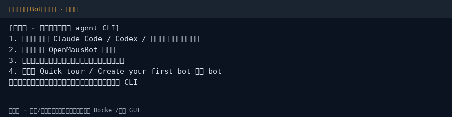

## 4. 第一次对话（桌面）



按下面顺序走一遍，确认「引擎 → 工作区 → 消息」通路：

1. **终端先通**：确认本机 agent CLI 已能交互（例如已登录的 Claude Code / Codex）。合规优先用你已有订阅或国内兼容封装，见第 8 章。
2. **打开 OpenMausBot**：桌面安装包，或 CLI 的 `setup` / `start` / `serve` 打开工作区。
3. **核对 Engines**：在模型 / Engines 选择器中确认引擎可用；不可用时按提示补安装，或到 Settings → Engines 改路径。
4. **创建第一个 bot**：按官网 Quick tour /「Create your first bot」新建；发一条简单消息（例如「用一句话介绍你自己」）验证通路。
5. **权限从紧**：若启用「控制本机 / 云桌面 / 应用连接」等能力，只开你需要的权限，**先在非敏感目录试用**。
6. **可选健康检查（CLI）**：

```bash
openmausbot doctor          # 检查服务是否应答、引擎是否就绪
openmausbot bots            # 列出 bot
openmausbot models          # 列出引擎与模型
```

手机配对、公网 tunnel、多租户 `fleet` 见第 6 章与官方文档。
